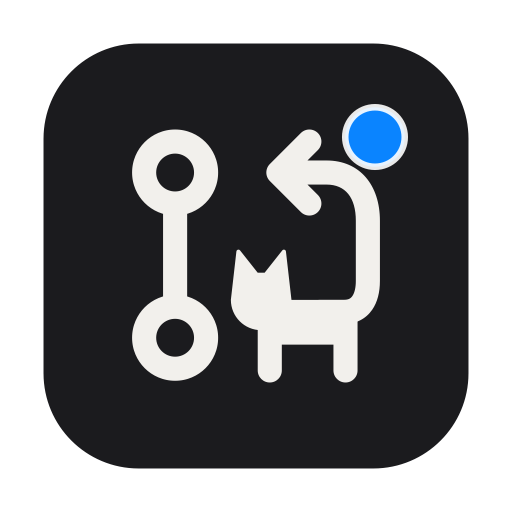
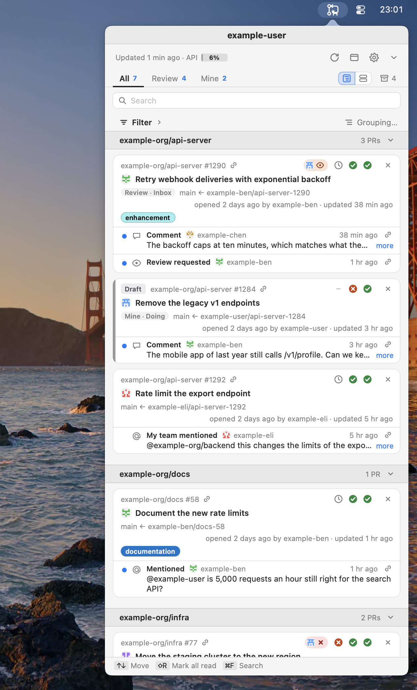
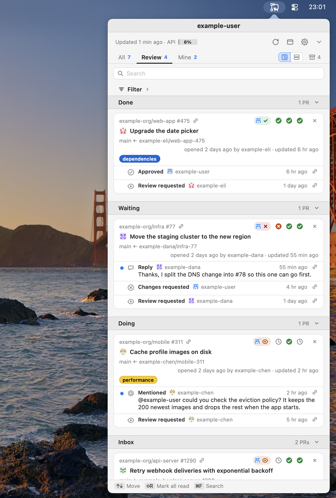
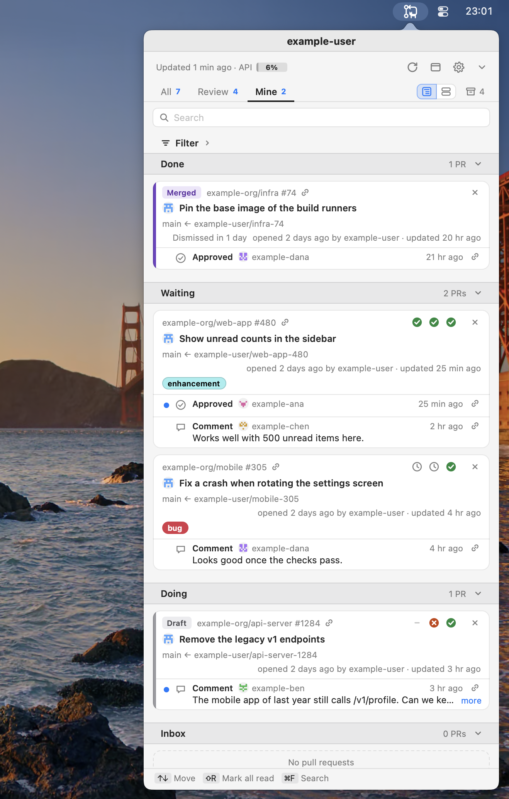
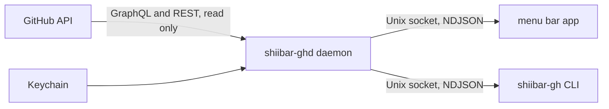

# shiibar-gh



macOS menu bar app for the GitHub pull requests you are involved in. It
tells you what happened on them (unread marks and notifications): the tab
All lists every PR you are involved in, grouped by repository, each card
with its latest events.



Notifications say what happened and on which PR; a click opens the
account's popover or window:


You keep the PRs you review and your own PRs in the order you choose, in
the tabs Review and Mine, each with the sections Done, Waiting, Doing and
Inbox:





Dismiss a PR when you are done with it; it comes back when someone mentions
you or your team, replies in a thread you take part in, requests your
review, or reopens it. Mute a repository, a user or a single PR to hide its
cards and silence them, except for mentions of you or your team. The Filter
of each tab narrows the list: show muted cards in gray or only them, pick
the statuses, or keep only the unread cards.
It only reads from GitHub. See `docs/DESIGN.md` and `CLAUDE.md`.

**Several GitHub accounts.** Each account has its own menu bar icon and one
classic personal access token (scopes `repo`, `notifications`, `read:org`).
Under an account you add owners (organizations or personal accounts) and,
if you like, Public.

**Popover or window.** Each account opens in a popover under its menu bar
icon, or in a window: Open in window and Open in popover switch between the
two, and the choice is remembered per account. In the window form a click on
the icon opens the window, brings it to the front, or closes it when it is
already in front. Keep on top (the pin) keeps the window above other
windows.

**Global shortcut.** Each account can have a key combination (Settings ›
Accounts › the account › Global shortcut) that does what a click on its menu
bar icon does, from any app.

**Upgrading.** Version 0.9 keeps everything from 0.8 and changes only the
app. Version 0.8 keeps everything from 0.7, 0.6, 0.5 and 0.4; the
section Todo is now named Inbox, and from 0.5 and 0.4 the cards of Mine start
in Inbox. Version 0.7 and earlier cannot read the saved state once 0.8 has
run. From 0.3 and 0.2 it keeps only the accounts (with their colors and order) and their tokens:
owners, event tables, settings, PRs and rows start empty, so add your
owners again. Version 0.2 and later do
not read the saved state or tokens of 0.1: add your accounts again.

## Permissions

Installing and running Shiibar GH asks for the following. Each one maps to a
specific feature.

- **Notifications**: needed to tell you what happened on your pull
  requests. The app asks the first time you open it.
- **Login Items**: the app registers itself to start at login the first
  time you open it. You can turn this off any time in Settings › General ›
  Launch at login; once you do, the app keeps that choice.
- **Keychain**: the daemon saves the token of every account in one
  generic password item of the Keychain (service `shiibar-gh`, account
  `accounts`). Nothing else reads or writes it.
- **A GitHub token per account**: a classic personal access token with the
  scopes `repo`, `notifications` and `read:org`. Shiibar GH only reads from
  GitHub with it.
- **Code signing**: the Homebrew cask ships a Developer ID–signed, notarized
  `.app`, with no local signing step. Building from source instead signs
  the app locally with a stable self-signed identity
  (`shiibar-gh-local-signing`, created in your login keychain on the first
  install), so that a rebuild keeps the Keychain access and the
  notification permission macOS ties to the app's signature. This only
  applies to the source build.
- **A state directory** (`~/.local/state/shiibar-gh/`): holds the daemon's
  Unix socket, its database (your accounts, owners, cards and settings) and
  its log. Nothing in it leaves your machine.

## Install / Uninstall

### Homebrew (recommended)

**Requirements**: macOS 14 (Sonoma) or later, Apple Silicon, and
[Homebrew](https://brew.sh). Intel Macs are not supported.

```sh
brew install --cask bufferings/tap/shiibar-gh
```

This installs `Shiibar GH.app` to `/Applications` and links the
`shiibar-gh` command into Homebrew's `bin`. Open Shiibar GH once (from
Spotlight or `/Applications`): it asks for the notification permission and
registers itself to launch at login. Then add an account in Settings ›
Accounts.

To uninstall:

```sh
brew uninstall --cask shiibar-gh
```

The tokens stay in the Keychain (service `shiibar-gh`, account `accounts`).
Run `shiibar-gh token reset` before uninstalling, or delete the item in
Keychain Access. `brew uninstall --zap --cask shiibar-gh` also removes the
saved state.

### Source build (developers)

Building from source is a development setup, not a substitute for the
Homebrew cask on Intel Macs: there is no Intel build.

**Requirements**: macOS 14 (Sonoma) or later, a Rust toolchain via
[rustup](https://rustup.rs) (the version pinned in `rust-toolchain.toml` is
installed automatically), and Xcode (the app is built with `swift build`;
its tests, `swift test`, need the full Xcode).

```sh
git clone https://github.com/bufferings/shiibar-gh.git
cd shiibar-gh
./scripts/dev-install.sh
```

This builds the daemon, the CLI and the app, bundles them as
`Shiibar GH(Dev).app` in `~/Applications` (the name and a `-dev` version
tell it from a release; it shares the release's identifiers, so the
Keychain item, the notification permission and the settings are the same),
signs it locally, links `shiibar-gh` into `~/.local/bin`, and launches the
app (a running one is stopped first).

To uninstall:

```sh
./scripts/dev-uninstall.sh           # quits the app; removes the Login Item,
                                     # the app, the ~/.local/bin link and the
                                     # local signing identity
./scripts/dev-uninstall.sh --purge   # also removes the state directory, the
                                     # app's saved preferences and the tokens
```

Either way, the notification permission itself can't be removed by a
script: macOS ties it to the app, and only System Settings › Notifications
can revoke it.

## How it works



- The daemon (`shiibar-ghd`) does all the work: it polls GitHub for each
  account (every minute by default, Settings › General › PR status
  interval), turns what happened into the rows of each card, decides which
  rows notify, and keeps the state. It only reads from GitHub.
- The daemon is the only part that touches the Keychain, where the tokens
  of all accounts live in one item (service `shiibar-gh`, account
  `accounts`).
- The menu bar app and the `shiibar-gh` CLI are both clients of the daemon
  over a Unix domain socket. The app starts the daemon and stops it when
  you quit; there is no launchd job. The app shows the macOS notifications
  the daemon decides on.
- The CLI does what the popover and Settings do, except the app's own
  state on this Mac (global shortcuts, the popover or window form) and
  Open in window / Open in popover. It reads tokens from stdin, never from
  arguments. `--help` lists the commands, and `--json` prints
  machine-readable output:

  ```sh
  shiibar-gh list --tab review --json
  shiibar-gh place owner/repo#123 review doing --account <login>
  ```

- All local state (the daemon's socket, its database and its log) lives
  under `~/.local/state/shiibar-gh/`.

## License

Licensed under either of

- Apache License, Version 2.0 ([LICENSE-APACHE](LICENSE-APACHE) or
  <https://www.apache.org/licenses/LICENSE-2.0>)
- MIT license ([LICENSE-MIT](LICENSE-MIT) or
  <https://opensource.org/licenses/MIT>)

at your option.

Unless you explicitly state otherwise, any contribution intentionally
submitted for inclusion in the work by you, as defined in the Apache-2.0
license, shall be dual licensed as above, without any additional terms or
conditions.
