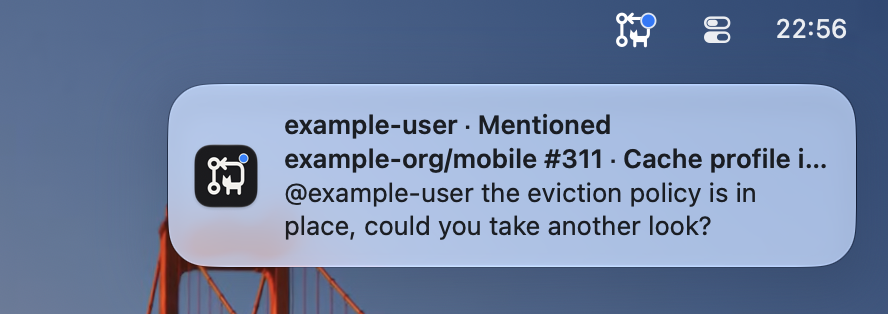

# shiibar-gh


macOS menu bar app for the GitHub pull requests you are involved in. It
tells you what happened on them (unread marks and notifications), and you
keep the PRs you review and your own PRs in the order you choose: the
popover has the tabs All, Review and Mine, the last two with the sections
Done, Waiting, Doing and Inbox.
Dismiss a PR when you are done with it; it comes back when someone mentions
you or your team, replies in a thread you take part in, requests your
review, or reopens it. Mute a repository, a user or a single PR to hide its
cards and silence them, except for mentions of you or your team. The Filter
of each tab narrows the list: show muted cards in gray or only them, pick
the statuses, or keep only the unread cards.
It only reads from GitHub. See `docs/DESIGN.md` and `CLAUDE.md`.


Notifications say what happened and on which PR; a click opens the
account's popover or window:



**Several GitHub accounts.** Each account has its own menu bar icon and one
classic personal access token (scopes `repo`, `notifications`, `read:org`).
Under an account you add owners (organizations or personal accounts) and,
if you like, Public.

**Popover or window.** Each account opens in a popover under its menu bar
icon, or in a window: Open in window and Open in popover switch between the
two, and the choice is remembered per account. In the window form a click on
the icon opens the window, brings it to the front, or closes it when it is
already in front. Keep on top (the pin) keeps the window above other
windows.


**Global shortcut.** Each account can have a key combination (Settings ›
Accounts › the account › Global shortcut) that does what a click on its menu
bar icon does, from any app.

**Upgrading.** Version 0.9 keeps everything from 0.8 and changes only the
app. Version 0.8 keeps everything from 0.7, 0.6, 0.5 and 0.4; the
section Todo is now named Inbox, and from 0.5 and 0.4 the cards of Mine start
in Inbox. Version 0.7 and earlier cannot read the saved state once 0.8 has
run. From 0.3 and 0.2 it keeps only the accounts (with their colors and order) and their tokens:
owners, event tables, settings, PRs and rows start empty, so add your
owners again. Version 0.2 and later do
not read the saved state or tokens of 0.1: add your accounts again.

## Install / Uninstall

**Requirements**: macOS 14 (Sonoma) or later, Apple Silicon, and
[Homebrew](https://brew.sh). Intel Macs are not supported.

```sh
brew install --cask bufferings/tap/shiibar-gh
```

This installs `Shiibar GH.app` to `/Applications` and links the
`shiibar-gh` command into Homebrew's `bin`. Open Shiibar GH once (from
Spotlight or `/Applications`): it asks for the notification permission and
registers itself to launch at login. Then add an account in Settings ›
Accounts.

To uninstall:

```sh
brew uninstall --cask shiibar-gh
```

The tokens stay in the Keychain (service `shiibar-gh`, account `accounts`).
Run `shiibar-gh token reset` before uninstalling, or delete the item in
Keychain Access. `brew uninstall --zap --cask shiibar-gh` also removes the
saved state.

## License

Licensed under either of

- Apache License, Version 2.0 ([LICENSE-APACHE](LICENSE-APACHE) or
  <https://www.apache.org/licenses/LICENSE-2.0>)
- MIT license ([LICENSE-MIT](LICENSE-MIT) or
  <https://opensource.org/licenses/MIT>)

at your option.

Unless you explicitly state otherwise, any contribution intentionally
submitted for inclusion in the work by you, as defined in the Apache-2.0
license, shall be dual licensed as above, without any additional terms or
conditions.
